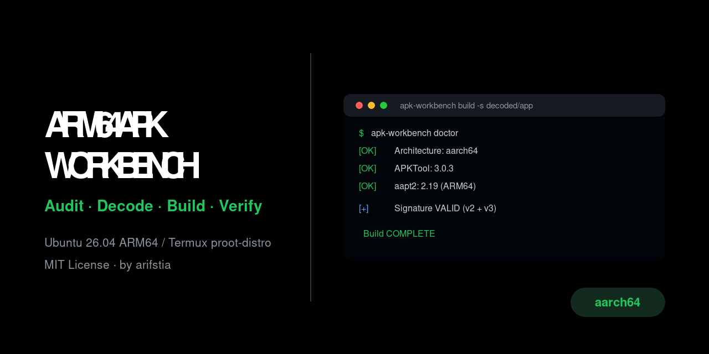

# ARM64 APK Workbench

**Workbench Modifikasi APK Android / Android APK Modification Workbench** — alat CLI otomatis untuk **audit, decode, build, sign, dan verifikasi APK** pada **Ubuntu 26.04 ARM64** dan **Termux proot-distro**.

Dibuat dan dipelihara oleh **arifstia** — https://github.com/arifstia

[](https://github.com/arifstia/arm64-apk-workbench/actions/workflows/smoke.yml)
[](https://github.com/arifstia/arm64-apk-workbench/releases/tag/v1.0.1)
[](https://github.com/arifstia/arm64-apk-workbench/stargazers)
[](https://github.com/arifstia/arm64-apk-workbench/forks)
[](https://github.com/arifstia/arm64-apk-workbench)
[](LICENSE)

> **Pilih bahasa / Choose language:** [🇮🇩 Bahasa Indonesia](#bahasa-indonesia) · [🇬🇧 English](#english) · [📖 Panduan lengkap ID](docs/ID.md)

**Instansi cepat / Quick install:**

```bash
git clone https://github.com/arifstia/arm64-apk-workbench.git && cd arm64-apk-workbench && chmod +x install.sh && ./install.sh
```



---

<a name="bahasa-indonesia"></a>

## 🇮🇩 Bahasa Indonesia

### Fitur

| Fitur | Deskripsi |
|-------|-----------|
| **Audit APK** | Analisis manifest, permission, DEX, native library, resource, dan sertifikat |
| **Mode performa** | `fast`, `normal`, `deep` — sesuai kebutuhan (deep menyertakan dekompilasi JADX) |
| **Cache audit** | Hasil di-cache per SHA-256 + mode; audit ulang hampir instan (deep: 62 dtk → 0,58 dtk) |
| **Decode APK** | Ekstrak resource dan Smali dengan APKTool 3.0.3 (mendukung targetSdk 37) |
| **Build APK** | Build ulang dari source hasil decode → zipalign → tanda tangan → verifikasi |
| **Sign & Verify** | Signing dengan test key dan verifikasi v1/v2/v3 via apksigner |
| **Backup otomatis** | Salinan APK dengan timestamp sebelum modifikasi |
| **Patch management** | Snapshot, diff, rollback, export & apply — semuanya dibackup |
| **Ramah ARM64** | RAM rendah, pemrosesan berurutan, tanpa binary x86_64 |
| **Aman** | APK asli tidak pernah ditimpa, backup tidak dihapus, tidak install APK otomatis |

### Persyaratan

- **Arsitektur:** ARM64 (`aarch64`)
- **Sistem:** Ubuntu 26.04 LTS atau Termux proot-distro
- **Python:** 3.14+ (dengan virtual environment)
- **Java:** OpenJDK 21+ (untuk APKTool & JADX)
- **RAM:** minimal 4 GB (disarankan 8 GB untuk APK besar)
- **Disk:** minimal 10 GB kosong

### Instalasi

```bash
git clone https://github.com/arifstia/arm64-apk-workbench.git
cd arm64-apk-workbench
chmod +x install.sh
./install.sh
```

Installer akan:
1. Memverifikasi arsitektur ARM64 dan tool sistem
2. Mengunduh **APKTool 3.0.3** dari rilis resmi + verifikasi SHA-256
3. Mengunduh **aapt2 ARM64 native** (ADT build-tools 37.0.0) + verifikasi SHA-256
4. Membuat wrapper `tools/bin/apktool` dan `tools/bin/aapt2`
5. Membangkitkan framework APKTool dari Android API 36
6. Menyiapkan virtual environment Python dan test keystore

Verifikasi instalasi:

```bash
./apk-workbench doctor
./apk-workbench tools
```

### Contoh Output Nyata

Hasil `doctor` di Ubuntu 26.04 ARM64 ( Termux proot-distro ):

```text
$ ./apk-workbench doctor
=== apk-workbench doctor ===
[OK]   Architecture: aarch64
[OK]   OS: Ubuntu 26.04.1 LTS
[OK]   Java: openjdk version "25.0.5.1"
[OK]   APKTool: 3.0.3
[OK]   apksigner: 0.9
[OK]   Androguard: androguard, version 4.1.4
All checks passed. Environment is ready.
```

Audit cepat:

```text
$ ./apk-workbench audit input/mini2.apk --mode fast
[+] Auditing: mini2.apk (mode=fast)
    SHA-256: ec83d412d74e65c5ba0804710c9d341095ddd76ce6017cdd3fcd7a9dae092af6
[+] Basic info & certificates...
[+] Manifest (Androguard)...
[+] Native libraries...
[+] Generating reports...
Reports generated:
  JSON: analysis/audit_mini2_TIMESTAMP.json
  Markdown: analysis/audit_mini2_TIMESTAMP.md
```

Build ulang APK targetSdk 37 (12 MB) hingga terverifikasi:

```text
$ ./apk-workbench build -s decoded/decoded_test_v3_full
    Compatibility: renamed 41 $-prefixed resources (recorded in patches/)
[1/5] Building APK with apktool...        OK (29.77s)
[2/5] Using existing test keystore.
[3/5] Zipaligning (4-byte alignment)...   OK (0.14s)
[4/5] Signing with test key...            OK (2.09s)
[5/5] Verifying signature...              Signature VALID
[+] Build COMPLETE and VERIFIED
    SHA-256: ce3dcb3a3c244086a3ea47e29ec8872981c2efe716b6333fc34686f8acd08577
```

### Mulai Cepat

```bash
# 1. Cek kesehatan sistem
apk-workbench doctor

# 2. Audit APK (mode normal)
apk-workbench audit input/app.apk

# 3. Audit cepat / mendalam
apk-workbench audit input/app.apk --mode fast
apk-workbench audit input/app.apk --mode deep

# 4. Backup APK asli
apk-workbench backup input/app.apk

# 5. Decode resource + Smali
apk-workbench decode input/app.apk

# 6. Build ulang dari hasil decode
apk-workbench build -s decoded/decoded_app_TIMESTAMP

# 7. Verifikasi APK hasil build
apk-workbench verify output/signed_decoded_app_TIMESTAMP.apk
```

### Referensi Perintah

| Perintah | Fungsi | Contoh |
|----------|--------|--------|
| `--help` | Bantuan umum | `apk-workbench --help` |
| `--version` | Versi CLI | `apk-workbench --version` |
| `doctor` | Cek sistem & toolchain | `apk-workbench doctor` |
| `tools` | Daftar tool + versi | `apk-workbench tools` |
| `audit` | Analisis APK | `apk-workbench audit app.apk --mode normal` |
| `analyze` | Alias untuk `audit` | `apk-workbench analyze app.apk` |
| `decode` | Decode resource & Smali | `apk-workbench decode app.apk` |
| `backup` | Backup APK ber-timestamp | `apk-workbench backup app.apk` |
| `build` | Build + sign + verify | `apk-workbench build -s decoded/decoded_app_TIMESTAMP` |
| `verify` | Verifikasi tanda tangan | `apk-workbench verify output/app.apk` |
| `patch` | Kelola snapshot/rollback | `apk-workbench patch -s decoded/decoded_app_TIMESTAMP` |

Opsi global:

```bash
--mode {fast,normal,deep}   # Mode audit (default: normal)
-s, --source DIR            # Direktori source untuk build/patch
-o, --output VALUE          # Output / deskripsi patch
-v, --verbose               # Output lebih detail
--no-cache                  # Paksa audit penuh, abaikan cache
--diff                      # patch: lihat perubahan sejak snapshot
--rollback                  # patch: pulihkan dari snapshot
--export                    # patch: ekspor perubahan jadi bundle
--apply --record ID         # patch: terapkan bundle ke source lain
--list                      # patch: daftar semua record
--dry-run                   # patch: pratinjau tanpa menulis
```

### Mode Audit

| Mode | Kapan dipakai | Keterangan |
|------|---------------|------------|
| `fast` | Smoke test / CI | Manifest, permission, library native |
| `normal` | Audit rutin | + resource dan jumlah file DEX |
| `deep` | Analisis mendalam | + dekompilasi JADX (±80 detik untuk APK 12 MB) |

**Cache audit:** hasil disimpan di `analysis/.cache/` berdasarkan SHA-256 APK dan mode.
Audit ulang langsung memakai cache (deep: 62 detik → 0,58 detik). Gunakan `--no-cache`
untuk memaksa analisis penuh, atau hapus `analysis/.cache/` untuk mengosongkan cache.

### Manajemen Patch

Sejak v1.1.0, `patch` benar-benar menyimpan salinan file — bukan sekadar hash — sehingga
perubahan bisa dibandingkan dan dipulihkan:

```bash
apk-workbench patch -s decoded/decoded_app_TIMESTAMP              # snapshot awal
apk-workbench patch -s decoded/decoded_app_TIMESTAMP --diff       # file berubah / baru / hilang
apk-workbench patch -s decoded/decoded_app_TIMESTAMP --rollback --dry-run
apk-workbench patch -s decoded/decoded_app_TIMESTAMP --rollback   # pulihkan (backup dulu)
apk-workbench patch --list                                        # semua record
apk-workbench patch -s decoded/app --export --bundle-name fix_x    # ekspor bundle
apk-workbench patch -s decoded/app2 --apply --record fix_x         # terapkan ke source lain
```

File yang ditimpa dipindah ke `backup/` sebelum ditulis; file baru yang muncul setelah
snapshot juga dipindah ke `backup/` saat rollback (tidak pernah dihapus). Symlink dan path
traversal ditolak. Record lama yang hanya berisi hash tidak bisa di-restore — buat snapshot
baru terlebih dahulu.

### Struktur Workspace

```
arm64-apk-workbench/
├── input/          # APK asli (read-only)
├── original/       # Salinan APK asli
├── backup/         # Backup dengan timestamp
├── decoded/        # Resource & Smali hasil decode
├── analysis/       # Laporan audit (JSON + Markdown)
├── patches/        # Snapshot & bundle patch (patches/snapshots/)
├── build/          # APK antara & keystore test
├── output/         # APK final yang sudah ditandatangani
├── logs/           # Log eksekusi
├── scripts/        # Mesin CLI (Python)
├── config/         # Konfigurasi
├── reports/        # Laporan akhir (release & performa)
├── tools/          # Wrapper tool (binary diunduh installer)
├── docs/           # Dokumentasi bahasa Indonesia
└── .venv/          # Virtual environment Python
```

### Alur Kerja

```text
input/app.apk
   │
   ├─► backup/           (backup otomatis)
   │
   ├─► decode/           (resource + Smali)
   │        │
   │        ├─► edit file Smali/XML sesuai kebutuhan
   │        │
   │        └─► patch record dicatat di patches/
   │
   └─► analysis/         (laporan audit JSON + Markdown)

decoded/ → build/ → zipalign → apksigner → output/ → verify
```

> **Catatan:** APK asli di `input/` tidak pernah dimodifikasi. Selalu bekerja pada salinan di `decoded/`.

### Toolchain

| Tool | Versi | Fungsi |
|------|-------|--------|
| JADX | 1.5.6 | Dekompiler DEX → Java/Kotlin |
| APKTool | 3.0.3 (project-local) | Decode/build resource & Smali, targetSdk 37 |
| apksigner | 0.9 | Signing & verifikasi APK |
| zipalign | 10.0 | Alignment ZIP APK |
| aapt / aapt2 | 2.19 | Android asset packaging |
| smali / baksmali | 2.5.2 | Assembly/disassembly DEX |
| Androguard | 4.1.4 | Analisis APK berbasis Python |

**Catatan ARM64:**
- APKTool 2.7 bawaan sistem gagal decode ARSC modern (`targetSdkVersion: 37`). Workbench memakai **APKTool 3.0.3** terverifikasi.
- aapt2 bawaan APKTool 3.x adalah binary **x86_64** dan tidak jalan di ARM64. Workbench memakai **aapt2 ARM64 native**.
- Framework dibangkitkan dari **Android API 36** agar resource `android:color/system_*` (targetSdk 35+) tersedia.
- Resource Material Components diawali `$` otomatis direname sebelum build dan dicatat di `patches/`.

### Laporan

- [`reports/PERFORMANCE_REPORT.md`](reports/PERFORMANCE_REPORT.md) — hasil pengukuran nyata
- [`reports/GITHUB_RELEASE_AUDIT.md`](reports/GITHUB_RELEASE_AUDIT.md) — audit kesiapan rilis
- [`TOOLCHAIN.md`](TOOLCHAIN.md) · [`WORKFLOW.md`](WORKFLOW.md) · [`docs/ID.md`](docs/ID.md)

### Artikel & Kontribusi

- [`docs/ARTIKEL_PROMOSI_ID.md`](docs/ARTIKEL_PROMOSI_ID.md) — artikel Bahasa Indonesia siap publish
- [`docs/PROMOTIONAL_ARTICLE_EN.md`](docs/PROMOTIONAL_ARTICLE_EN.md) — English version
- [`docs/AWESOME_LIST_ENTRIES.md`](docs/AWESOME_LIST_ENTRIES.md) — entri siap pakai untuk awesome-list
- [`CONTRIBUTING.md`](CONTRIBUTING.md) — cara berkontribusi · [`CODE_OF_CONDUCT.md`](CODE_OF_CONDUCT.md)

CI smoke test berjalan otomatis setiap push (`python3 -m unittest discover -s tests -v`).

### Keamanan & Etika

Tool ini **hanya untuk penggunaan yang sah** — menganalisis atau memodifikasi APK yang Anda miliki atau memiliki izin untuk memodifikasinya. Workbench **tidak pernah** menimpa APK asli, menghapus backup, menginstall APK otomatis, menyertakan private key pihak ketiga, atau mengaktifkan fitur penyalahgunaan. Lihat [SECURITY.md](SECURITY.md).

### Lisensi

MIT License — lihat [LICENSE](LICENSE). Copyright (c) 2026 **arifstia**.

---

<a name="english"></a>

## 🇬🇧 English

### Features

| Feature | Description |
|---------|-------------|
| **APK Audit** | Manifest, permissions, DEX, native libraries, resources and certificates |
| **Performance modes** | `fast`, `normal`, `deep` (deep includes JADX decompilation) |
| **Audit caching** | Results cached per SHA-256 + mode; repeat audits are near-instant (deep: 62 s → 0.58 s) |
| **Decode APK** | Extract resources and Smali with APKTool 3.0.3 (targetSdk 37 support) |
| **Build APK** | Rebuild from decoded source → zipalign → sign → verify |
| **Sign & Verify** | Test-key signing and v1/v2/v3 verification via apksigner |
| **Automatic backup** | Timestamped copy before any modification |
| **Patch management** | Snapshot, diff, rollback, export & apply — always backed up |
| **ARM64 friendly** | Low RAM, sequential processing, no x86_64 binaries |
| **Safe** | Originals are never overwritten, backups never deleted, no auto-install |

### Requirements

- **Architecture:** ARM64 (`aarch64`)
- **OS:** Ubuntu 26.04 LTS or Termux proot-distro
- **Python:** 3.14+ (with virtual environment)
- **Java:** OpenJDK 21+ (APKTool & JADX)
- **RAM:** 4 GB minimum (8 GB recommended for large APKs)
- **Disk:** 10 GB free space

Bundled tools: JADX 1.5.6, APKTool 3.0.3, apksigner, zipalign, aapt/aapt2, smali/baksmali 2.5.2, Androguard 4.1.4.

### Installation

```bash
git clone https://github.com/arifstia/arm64-apk-workbench.git
cd arm64-apk-workbench
chmod +x install.sh
./install.sh
```

The installer will:
1. Verify ARM64 architecture and system tools
2. Download **APKTool 3.0.3** from the official release + verify SHA-256
3. Download **native ARM64 aapt2** (ADT build-tools 37.0.0) + verify SHA-256
4. Create `tools/bin/apktool` and `tools/bin/aapt2` wrappers
5. Generate the APKTool framework from Android API 36
6. Set up the Python virtual environment and test keystore

Verify the installation:

```bash
./apk-workbench doctor
./apk-workbench tools
```

### Real Output Examples

`doctor` on Ubuntu 26.04 ARM64 (Termux proot-distro):

```text
$ ./apk-workbench doctor
=== apk-workbench doctor ===
[OK]   Architecture: aarch64
[OK]   OS: Ubuntu 26.04.1 LTS
[OK]   Java: openjdk version "25.0.5.1"
[OK]   APKTool: 3.0.3
[OK]   apksigner: 0.9
[OK]   Androguard: androguard, version 4.1.4
All checks passed. Environment is ready.
```

Fast audit:

```text
$ ./apk-workbench audit input/mini2.apk --mode fast
[+] Auditing: mini2.apk (mode=fast)
    SHA-256: ec83d412d74e65c5ba0804710c9d341095ddd76ce6017cdd3fcd7a9dae092af6
[+] Basic info & certificates...
[+] Manifest (Androguard)...
[+] Native libraries...
[+] Generating reports...
Reports generated:
  JSON: analysis/audit_mini2_TIMESTAMP.json
  Markdown: analysis/audit_mini2_TIMESTAMP.md
```

Rebuilding a 12 MB targetSdk 37 APK, through signature verification:

```text
$ ./apk-workbench build -s decoded/decoded_test_v3_full
    Compatibility: renamed 41 $-prefixed resources (recorded in patches/)
[1/5] Building APK with apktool...        OK (29.77s)
[2/5] Using existing test keystore.
[3/5] Zipaligning (4-byte alignment)...   OK (0.14s)
[4/5] Signing with test key...            OK (2.09s)
[5/5] Verifying signature...              Signature VALID
[+] Build COMPLETE and VERIFIED
    SHA-256: ce3dcb3a3c244086a3ea47e29ec8872981c2efe716b6333fc34686f8acd08577
```

### Quick Start

```bash
# 1. System health check
apk-workbench doctor

# 2. Audit an APK (normal mode)
apk-workbench audit input/app.apk

# 3. Fast / deep audit
apk-workbench audit input/app.apk --mode fast
apk-workbench audit input/app.apk --mode deep

# 4. Back up the original APK
apk-workbench backup input/app.apk

# 5. Decode resources and Smali
apk-workbench decode input/app.apk

# 6. Rebuild from decoded source
apk-workbench build -s decoded/decoded_app_TIMESTAMP

# 7. Verify the built APK
apk-workbench verify output/signed_decoded_app_TIMESTAMP.apk
```

### Command Reference

| Command | Purpose | Example |
|---------|---------|---------|
| `--help` | Show help | `apk-workbench --help` |
| `--version` | CLI version | `apk-workbench --version` |
| `doctor` | Check system & toolchain | `apk-workbench doctor` |
| `tools` | List tools + versions | `apk-workbench tools` |
| `audit` | Analyze APK | `apk-workbench audit app.apk --mode normal` |
| `analyze` | Alias for `audit` | `apk-workbench analyze app.apk` |
| `decode` | Decode resources & Smali | `apk-workbench decode app.apk` |
| `backup` | Timestamped backup | `apk-workbench backup app.apk` |
| `build` | Build + sign + verify | `apk-workbench build -s decoded/decoded_app_TIMESTAMP` |
| `verify` | Verify signature | `apk-workbench verify output/app.apk` |
| `patch` | Manage snapshots/rollback | `apk-workbench patch -s decoded/decoded_app_TIMESTAMP` |

Global options:

```bash
--mode {fast,normal,deep}   # Audit mode (default: normal)
-s, --source DIR            # Source directory for build/patch
-o, --output VALUE          # Output / patch description
-v, --verbose               # Verbose output
--no-cache                  # Force a full audit, ignore cache
--diff                      # patch: show changes since snapshot
--rollback                  # patch: restore from snapshot
--export                    # patch: export edits as a bundle
--apply --record ID         # patch: apply a bundle to another source
--list                      # patch: list every record
--dry-run                   # patch: preview without writing
```

### Audit Modes

| Mode | When to use | Details |
|------|-------------|---------|
| `fast` | CI / smoke tests | Manifest, permissions, native libraries |
| `normal` | Routine audits | + resources and DEX file count |
| `deep` | In-depth analysis | + JADX decompilation (~80 s for a 12 MB APK) |

**Audit cache:** results are stored in `analysis/.cache/`, keyed by APK SHA-256 and mode.
Repeat audits reuse the cache (deep: 62 s → 0.58 s). Use `--no-cache` to force a full
analysis, or delete `analysis/.cache/` to clear it.

### Patch Management

Since v1.1.0, `patch` stores real file copies — not just hashes — so edits can be compared
and restored:

```bash
apk-workbench patch -s decoded/decoded_app_TIMESTAMP               # baseline snapshot
apk-workbench patch -s decoded/decoded_app_TIMESTAMP --diff        # modified / added / deleted
apk-workbench patch -s decoded/decoded_app_TIMESTAMP --rollback --dry-run
apk-workbench patch -s decoded/decoded_app_TIMESTAMP --rollback    # restore (backup first)
apk-workbench patch --list                                         # every record
apk-workbench patch -s decoded/app --export --bundle-name fix_x     # export a bundle
apk-workbench patch -s decoded/app2 --apply --record fix_x          # apply to another source
```

Overwritten files are moved to `backup/` before writing; files created after the snapshot
are moved to `backup/` on rollback (nothing is ever deleted). Symlinks and path traversal are
rejected. Legacy hash-only records cannot be restored — create a new snapshot first.

### Workspace Structure

```
arm64-apk-workbench/
├── input/          # Original APKs (read-only)
├── original/       # Copies of originals
├── backup/         # Timestamped backups
├── decoded/        # Decoded resources & Smali
├── analysis/       # Audit reports (JSON + Markdown)
├── patches/        # Patch snapshots & bundles (patches/snapshots/)
├── build/          # Intermediate APKs & test keystore
├── output/         # Final signed APKs
├── logs/           # Execution logs
├── scripts/        # CLI engine (Python)
├── config/         # Configuration
├── reports/        # Final reports (release & performance)
├── tools/          # Tool wrappers (binaries downloaded by installer)
├── docs/           # Indonesian documentation
└── .venv/          # Python virtual environment
```

### Workflow

```text
input/app.apk
   │
   ├─► backup/           (automatic backup)
   │
   ├─► decode/           (resources + Smali)
   │        │
   │        ├─► edit Smali/XML as needed
   │        │
   │        └─► patch record written to patches/
   │
   └─► analysis/         (JSON + Markdown audit reports)

decoded/ → build/ → zipalign → apksigner → output/ → verify
```

> **Note:** APKs in `input/` are never modified. Always work on a copy in `decoded/`.

### Toolchain

| Tool | Version | Purpose |
|------|---------|---------|
| JADX | 1.5.6 | DEX → Java/Kotlin decompiler |
| APKTool | 3.0.3 (project-local) | Resource/Smali decode & build, targetSdk 37 |
| apksigner | 0.9 | APK signing & verification |
| zipalign | 10.0 | APK ZIP alignment |
| aapt / aapt2 | 2.19 | Android asset packaging |
| smali / baksmali | 2.5.2 | DEX assembly/disassembly |
| Androguard | 4.1.4 | Python-based APK analysis |

**ARM64 notes:**
- System APKTool 2.7 cannot decode modern ARSC (`targetSdkVersion: 37`); this project uses verified **APKTool 3.0.3**.
- APKTool 3.x ships an **x86_64** aapt2 that cannot run on ARM64; this project uses **native ARM64 aapt2**.
- The framework is generated from **Android API 36** so `android:color/system_*` resources (targetSdk 35+) resolve.
- Material Components resources starting with `$` are renamed before build and recorded in `patches/`.

### Reports

- [`reports/PERFORMANCE_REPORT.md`](reports/PERFORMANCE_REPORT.md) — measured timings
- [`reports/GITHUB_RELEASE_AUDIT.md`](reports/GITHUB_RELEASE_AUDIT.md) — release readiness audit
- [`TOOLCHAIN.md`](TOOLCHAIN.md) · [`WORKFLOW.md`](WORKFLOW.md) · [`docs/ID.md`](docs/ID.md)

### Articles & Contributing

- [`docs/ARTIKEL_PROMOSI_ID.md`](docs/ARTIKEL_PROMOSI_ID.md) — ready-to-publish Indonesian article
- [`docs/PROMOTIONAL_ARTICLE_EN.md`](docs/PROMOTIONAL_ARTICLE_EN.md) — English version
- [`docs/AWESOME_LIST_ENTRIES.md`](docs/AWESOME_LIST_ENTRIES.md) — ready-to-paste awesome-list entries
- [`CONTRIBUTING.md`](CONTRIBUTING.md) · [`CODE_OF_CONDUCT.md`](CODE_OF_CONDUCT.md)

A CI smoke test runs on every push (`python3 -m unittest discover -s tests -v`).

### Security & Ethics

This toolset is for **authorized use only** — analyzing or modifying APKs you own or have permission to modify. It **never** overwrites originals, deletes backups, installs APKs automatically, ships third-party private keys, or enables abuse features. See [SECURITY.md](SECURITY.md).

### License

MIT License — see [LICENSE](LICENSE). Copyright (c) 2026 **arifstia**.
